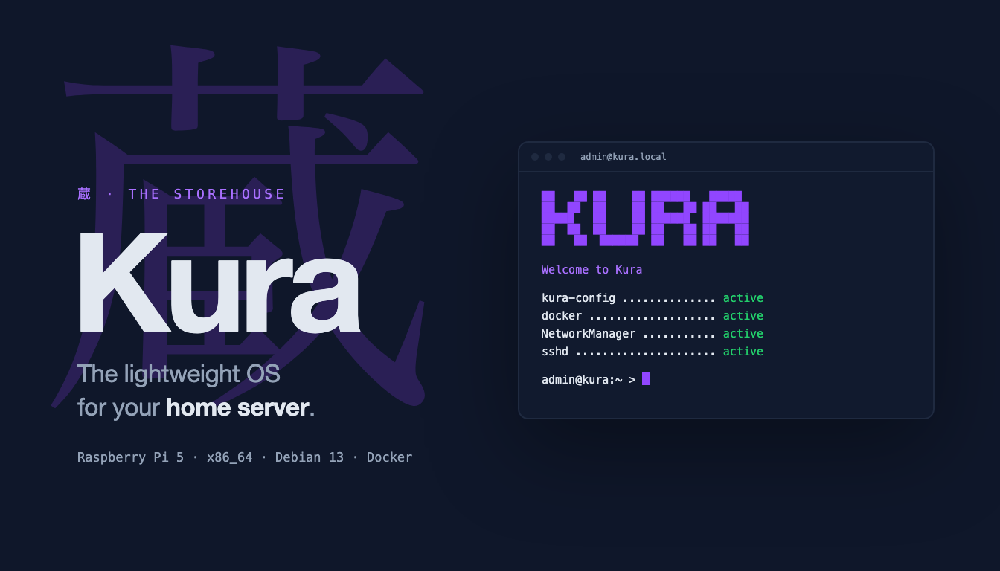

<p align="center">
  <picture>
    <source media="(prefers-color-scheme: dark)" srcset=".github/banner-dark.png">
    <source media="(prefers-color-scheme: light)" srcset=".github/banner-light.png">
    
  </picture>
</p>

<p align="center">
  <a href="https://github.com/cbabil/kura/actions/workflows/ci.yml"></a>
  
  
  
  
</p>

# Kura

A lightweight home-server OS built on Debian 13 (Trixie) for the Raspberry Pi 5 and x86_64. Hardened Debian with Docker, nothing else running that you didn't ask for, and no cloud service to talk to. Flash it with [Etchwise](#etchwise) to choose the hostname, user, password, SSH keys and Wi-Fi before the first boot.

## Features

- **Debian-based**: Built on Debian 13 (Trixie) for broad hardware and package support
- **mmdebstrap rootfs**: Reproducible, minimal root filesystem generation
- **Docker built in**: Docker Engine and Compose from Docker's APT repository (signing key fingerprint pinned)
- **First boot**: grows the root partition to fill the disk, generates this device's own SSH host keys and machine ID, and applies the settings an imager left on the boot partition (`kura-setup.json`)
- **Three targets**: RPi5 SD card image, x86_64 live ISO (demo: data is lost at reboot), and a Docker rootfs
- **Security**: hardening at boot (kernel, AppArmor, seccomp, SSH, firewall)
- **Network Management**: NetworkManager for flexible configuration
- **Rebrandable**: All user-visible branding controlled via `.env` variables

## Quick Start

### 1. Set up Build VM

Create a Debian/Ubuntu VM with:
- 2+ CPU cores
- 4GB+ RAM (8GB recommended)

**Disk Partitioning:**

| Mount | Minimal | Recommended | Purpose |
|-------|---------|-------------|---------|
| `/` | 10GB | 15GB | OS, tools, packages |
| `/tmp` | 2GB | 5GB | Temporary build files |
| `/home` | 5GB | 10GB | Source, builds, releases |
| `swap` | 2GB | 4GB | Swap |
| **Total** | **20GB** | **35GB** | |

**Note:** All configurable values are in `.env`. Copy the template on first setup: `cp .env.example .env`

### 2. Prerequisites

The build VM needs a working HTTPS connection and up-to-date CA certificates:

```bash
sudo apt-get update
sudo apt-get install -y ca-certificates curl git
```

If `apt-get update` fails with SSL errors (fresh minimal install), temporarily bypass TLS verification to bootstrap certificates:

```bash
sudo apt-get -o Acquire::https::Verify-Peer=false update
sudo apt-get install -y ca-certificates
sudo update-ca-certificates
```

### 3. Install

```bash
# Create project directory
mkdir -p /home/os-build
cd /home/os-build

# Clone repository (or rsync from dev machine)
git clone <repo-url> .

# Create local config from template
cp .env.example .env

# Setup (installs host dependencies)
./build.sh setup

# Optional: create a system-wide symlink for convenience
sudo ln -sf "$(pwd)/build.sh" /usr/local/bin/kura
```

### 4. Build

```bash
./build.sh build all        # Build all targets (clean build)
./build.sh build iso        # Build x86_64 only (incremental)
./build.sh build rpi5       # Build RPi5 only (incremental)

# Or with the symlink:
kura build iso
```

**Note:** Every image boots with Docker ready, and works offline. Building needs internet for Debian and Docker packages.

### CI builds

GitHub Actions builds both images on every push to `dev` that changes build inputs, and on manual runs (**Actions → Images → Run workflow**). The x86 ISO is also booted headless **without internet** to check that:
- first boot finishes;
- the default password only reaches a forced change;
- the core services are running and Docker answers;
- two boots of the same image get different SSH host keys and machine IDs.

Download the images from the run's artifacts (`kura-iso-<sha>`, `kura-rpi5-<sha>`, kept 7 days). They are **test builds** with `.env.example`'s default credentials, not for distribution. To run the boot test locally on Linux with QEMU:

```bash
tests/boot/iso-boot-test.sh release/<version>/iso/kura-*.iso boot-a
```

### Releases

Pushing a `v*` tag builds both images and publishes a GitHub Release with the Pi image (`.img.zst`), the ISO, `SHA512SUMS`, `manifest.json` and `etchwise.json` (the OS list Etchwise reads). Every asset is signed keylessly with [Sigstore](https://www.sigstore.dev/) by the release workflow itself, so there is no signing key to manage; each asset ships with a `<asset>.sigstore.json` bundle. To verify a download (needs [cosign](https://github.com/sigstore/cosign)):

```bash
scripts/release/verify-release.sh kura-0.1.0-rpi5-arm64-20260929-0001.img.zst v0.1.0
```

Release images are built from `.env.example`: the `admin` password must be replaced at the first login and root has no password (see [Default Credentials](#default-credentials)).

## Configuration

All tunable build values live in `.env` at the project root. Copy the template on first setup (`cp .env.example .env`), edit values, and rebuild.

**Config Version**

| Variable | Description | Default |
|----------|-------------|---------|
| `OS_CONF_VERSION` | .env format version (for upgrade warnings) | `4` |

**Debian Base**

| Variable | Description | Default |
|----------|-------------|---------|
| `OS_DEBIAN_SUITE` | Debian suite for mmdebstrap | `trixie` |
| `OS_DEBIAN_MIRROR` | APT mirror URL | `http://deb.debian.org/debian` |
| `OS_CROSS_BUILD` | Cross-compilation mode | `auto` (auto\|yes\|no) |

**Parallelism**

| Variable | Description | Default |
|----------|-------------|---------|
| `OS_PARALLEL_JOBS` | Parallel make jobs | `$(nproc)` |

**Branding**

| Variable | Description | Default |
|----------|-------------|---------|
| `OS_BRAND` | Lowercase prefix for paths, services, user/group | *(see brand-defaults.sh)* |
| `OS_NAME` | Display name shown in banners, MOTD, logs | *(see brand-defaults.sh)* |
| `OS_COLOR` | Brand accent color (hex) | `#9146FF` |

**Distribution**

| Variable | Description | Default |
|----------|-------------|---------|
| `OS_VERSION` | Release version baked into images | `0.0.1` |
| `OS_HOSTNAME` | Default hostname | `kura` |
| `OS_USER` | Login user (SSH password auth) | `admin` |
| `OS_USER_PASSWD` | Login user password (plaintext) | `admin` |
| `OS_ROOT_PASSWD` | Root console password (plaintext; root SSH is key-only). Empty locks root | empty (locked) |
| `OS_USER_PASSWD_EXPIRE` | Force the login user to set a new password at first login; `false` keeps `OS_USER_PASSWD` | `true` |
| `OS_ISSUE` | Login banner | `Welcome to ${OS_NAME}` |

**Network**

| Variable | Description | Default |
|----------|-------------|---------|
| `OS_DHCP_INTERFACE` | Interface for DHCP at first boot | `eth0` |

**Logging**

| Variable | Description | Default |
|----------|-------------|---------|
| `OS_JOURNAL_MAX_SIZE` | Max systemd journal size | `100M` |
| `OS_JOURNAL_MAX_FILE_SEC` | Max journal file age | `1week` |

**Filesystem**

| Variable | Description | Default |
|----------|-------------|---------|
| `OS_ROOTFS_SIZE` | RPi5 rootfs ext4 + partition size | `2G` |

**Build Directories**

| Variable | Description | Default |
|----------|-------------|---------|
| `OS_TMP` | Temp directory for builds | `/home/${OS_BRAND}/tmp` |

## Commands

| Command | Description |
|---------|-------------|
| `setup` | Install host dependencies for Debian builds |
| `build [target]` | Build OS image (mmdebstrap + overlays) |
| `clean` | Remove build rootfs and temp files |
| `help` | Show help |

**Build targets:**
- `iso` - x86_64: creates ISO + Docker image (incremental)
- `rpi5` - ARM64: creates SD card image + Docker image (incremental)
- `docker` - Docker image only
- `all` - Build both targets (clean build, default)

## Output Files

```
release/<version>/
├── arm64/
│   └── <brand>-<version>-rpi5-arm64-YYYYMMDD-NNNN.img
├── iso/
│   └── <brand>-<version>-x86_64-amd64-YYYYMMDD-NNNN.iso
└── docker/
    ├── <brand>-<version>-rpi5-arm64-YYYYMMDD-NNNN.tar
    └── <brand>-<version>-x86_64-amd64-YYYYMMDD-NNNN.tar
```

`NNNN` is an auto-incremented build sequence number (zero-padded, stored in `.build-number`).

**Docker images:**
- `kura:latest-arm64` - RPi5 build
- `kura:latest-amd64` - x86_64 build

## Deploying

### Default Credentials

| User | Password | SSH Access |
|------|----------|------------|
| `admin` | `admin`, expired: the first SSH or console login must set a new one | Password auth |
| `root` | locked | None by password; use `sudo` from `admin` |

The `admin` password only gets you to the change-password prompt, so no device keeps it. Root has no password: with root locked, systemd's emergency mode can't open a shell, so a system that won't boot is repaired from another machine (or build with a private `OS_ROOT_PASSWD`). Change the defaults in `.env` (`OS_USER`, `OS_USER_PASSWD`, `OS_ROOT_PASSWD`) before building; set `OS_USER_PASSWD_EXPIRE="false"` to keep a private `OS_USER_PASSWD`.

### Etchwise

Etchwise (a multi-device imager based on Raspberry Pi Imager) lists Kura under Raspberry Pi 5 (from each release's `etchwise.json`). Its setup screens become `kura-setup.json` on the card's boot partition; first boot validates it, applies it before SSH starts, and deletes it (it holds the password hash and Wi-Fi key). An invalid file is ignored and the image defaults stay. Format and rules: `scripts/common/firstboot-setup.sh`.

### RPi5 - Flash SD Card

```bash
sudo dd if=release/<version>/arm64/kura-*.img of=/dev/sdX bs=4M status=progress
sync
```

Boot the Pi on your network, wait for first boot to finish (it grows the root partition), then `ssh admin@kura.local`. If the root partition is too small for the image, the build stops and names the `OS_ROOTFS_SIZE` to set.

### x86_64 - Boot ISO in VM

The ISO is a live system that runs from RAM: containers and data are lost at every reboot. Use it to try Kura; a persistent x86 disk image is planned.

```bash
# QEMU
qemu-system-x86_64 -cdrom release/<version>/iso/kura-*.iso -m 2048 -enable-kvm

# Proxmox - Upload ISO and create VM via web UI
scp release/<version>/iso/kura-*.iso root@proxmox:/var/lib/vz/template/iso/
```

### Docker

Docker images are created automatically with each build and imported into the local Docker daemon.

```bash
# Run a built image
docker run -it kura:latest-amd64 /bin/bash   # x86_64
docker run -it kura:latest-arm64 /bin/bash   # RPi5/ARM64

# Import from tarball (e.g. on another machine)
docker import release/<version>/docker/kura-*-amd64-*.tar kura:latest-amd64
docker import release/<version>/docker/kura-*-arm64-*.tar kura:latest-arm64
```

## Project Structure

```
├── .env.example          # Build config template (cp to .env)
├── .env                  # Local build config (gitignored)
├── build.sh              # Main build script
├── config/               # Package lists per target
├── packages/             # OS package sources (os-config, os-security)
├── overlay/              # Filesystem overlays (common, rpi5, x86_64)
├── scripts/              # Build scripts (common, rpi5, x86_64, docker)
├── tests/shell/          # Shell script tests (bats)
└── release/              # Output images
```

## Rebranding

The OS can be rebranded by editing variables in `.env`:

```bash
OS_BRAND="myco"           # paths: /etc/myco/, services: myco-config
OS_NAME="MyCo OS"         # display name in banners and logs
```

Default brand values are defined in `scripts/common/brand-defaults.sh` (single source of truth).

After changing these values, rebuild (`./build.sh build all`). The build system propagates branding through:

- **Build scripts**: `${OS_BRAND}` substitution for paths, artifact names, Docker tags
- **Service files**: `__BRAND__` / `__BRAND_NAME__` placeholders, sed-replaced at install
- **Runtime**: `/etc/${BRAND}/brand.env` generated at build, read by the MOTD
- **Dockerfile**: `--build-arg BRAND` for container user/group/workdir

**What stays static** (not affected by rebranding):
- Source filenames in `packages/` (installed under branded names)
- The bootstrap path `/etc/kura/brand.env` (hardcoded discovery point)

## License

Licensed under the GNU License. See [LICENSE](LICENSE) for details.
